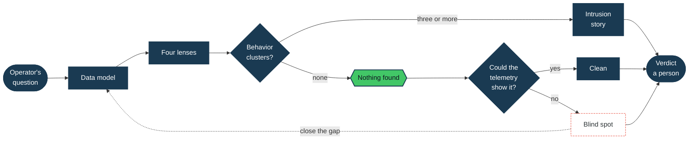

<!--
**TacticalDetect/TacticalDetect** is a ✨ _special_ ✨ repository because its `README.md` (this file) appears on your GitHub profile.
Banner: replace the user-attachments URL below with assets/tacticaldetect_four_moves.png once the image is committed to this repo.
--->

  

<h2 align="center">🔍 Whoami</h2>

  <samp>
  Lead Threat Hunter at an MDR firm, with 12+ years across military cyber operations and enterprise defense. I lead hunts across hundreds of client environments on Splunk-based SIEMs, and I write about the part most hunt reports skip. Most hunts end with nothing found. The hard part is knowing whether that means the environment is clean or the telemetry never showed you the answer.
  </samp>
    
  <samp>Detection Engineering | Link Analysis | Unsupervised ML | Splunk | MITRE ATT&CK</samp>
    

<h2 align="center">🧭 How I Hunt</h2>

  <samp>Author of a security analytics framework built on a 6W data model, a Four-Lens Visualization Grammar, and one principle. Hunt what the attacker cannot avoid. Identities rotate. Mechanisms persist.</samp>

<table>
<tr>
<td width="25%" align="center">

**📊 Statistical Lens**
 
Prevalence, rarity, and baselines that tell you how unusual a behavior is

</td>
<td width="25%" align="center">

**🕸️ Relationship Lens**
 
Property graphs that show what tables obscure

</td>
<td width="25%" align="center">

**🧩 Semantic Lens**
 
Behavioral clustering across low-fidelity observations

</td>
<td width="25%" align="center">

**⏱️ Temporal Lens**
 
Sequence and timing that turn clusters into an intrusion story

</td>
</tr>
</table>

  <samp>The questions an analyst must answer drive the data model. Three or more behavior clusters start to tell an intrusion story. Investigations run from first harm signal forward to worst case, then backward to fill gaps until the narrative is complete.</samp>

<h2 align="center">📉 Why Finding Nothing Is a Result</h2>

  <samp>Most hunts end with nothing found. The hard part is knowing which branch you are on.</samp>

<h2 align="center">🛠️ Tools of Trade</h2>

<h3 align="center">Security Platforms</h3>

  &nbsp;&nbsp;
  &nbsp;&nbsp;
  &nbsp;&nbsp;
  &nbsp;&nbsp;

<h3 align="center">Query Languages</h3>

  &nbsp;&nbsp;
  &nbsp;&nbsp;
  &nbsp;&nbsp;
  &nbsp;&nbsp;

<h3 align="center">Threat Intelligence & Analysis</h3>

  &nbsp;&nbsp;
  &nbsp;&nbsp;
  &nbsp;&nbsp;
  &nbsp;&nbsp;
  &nbsp;&nbsp;

<h3 align="center">Development & Automation</h3>

  &nbsp;&nbsp;
  &nbsp;&nbsp;
  &nbsp;&nbsp;
  &nbsp;&nbsp;
  &nbsp;&nbsp;

<h3 align="center">Visualization & Analytics</h3>

  &nbsp;&nbsp;
  &nbsp;&nbsp;
  &nbsp;&nbsp;

<h2 align="center">💡 Current Focus</h2>

  <samp>
    🕸️ TacticalGraph, a property graph investigation layer built on Splunk Network Diagram Viz 
    📉 Confirmed negatives, or why finding nothing can mean the hunt worked 
    🧩 Role resolution, telling who participated in a behavior from who merely got mentioned 
    🤖 Where AI belongs in a hunt. The search does the math, AI helps plan and read, a person owns the verdict 
    🧰 A skill library for hunt mission planning, graph construction, SPL, SPL2, and KQL hunting 
  </samp>

<h2 align="center">📝 Writing & Research</h2>

  <samp>
    <b>Can't Hide in 3D</b> (THOR Collective Dispatch, Sep 2025) 
    <b>Trojan Packages</b> (Deepwatch, Oct 2025) 
    <b>Your Device Code Phishing Detection Probably Doesn't Work</b> (Deepwatch, May 2026) 
    <b>Five Ideas, One Hunt</b> (TacticalDetect Substack, Oct 2026) 
     
    "Can't Hide in 3D" is among the first practical SPL implementations of MITRE's Time-Terrain-Behavior framework. Featured in Detection Engineering Weekly's "State of the Art" and extended in <i>Advanced Cyber Threat Intelligence and Hunting</i> (Tiepolo and Sorensen, Packt, 2026). 
    Expert commentary cited across the Wall Street Journal, CSO Online, Dark Reading, SC World, MSSP Alert, and PCMag. 14 citations across 10 publications.
  </samp>

  &nbsp;&nbsp;&nbsp;
  

<h2 align="center">🔍 Projects & Tools</h2>

  

  <samp>The SPL behind "Can't Hide in 3D", MIT licensed.</samp>

<h2 align="center">📫 Connect</h2>

  &nbsp;&nbsp;&nbsp;&nbsp;

  <samp><i>I am an employee of Deepwatch. All comments, posts, and thoughts are my own and do not necessarily reflect the positions, strategies, or opinions of the company.</i></samp>

